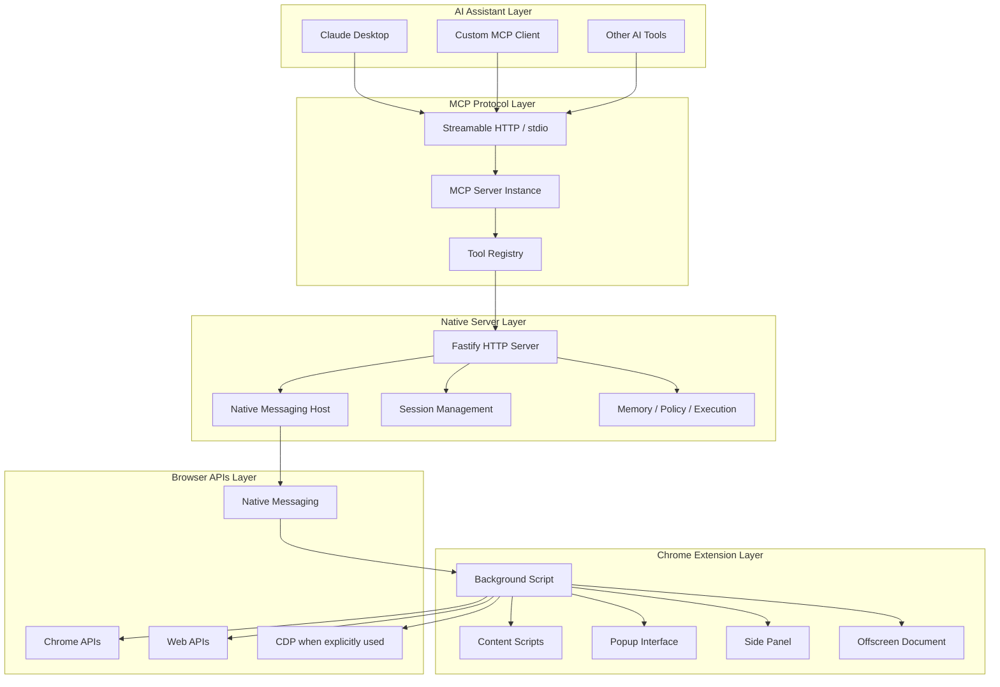

# Tabrix Architecture

This document provides a technical overview of the Tabrix codebase architecture and major runtime paths.

Scope note:

- The stable public product surface is centered on the Chrome extension browser runtime plus MCP access through `Streamable HTTP` and `stdio`.
- Chrome APIs provide the default browser execution and sensing substrate. CDP is a bounded, explicitly used sensing and diagnostics enhancer for page-state, frame, network, console, visual, and post-action understanding; it must not become the default public control surface.
- Legacy semantic-indexing, agent, workflow, local-model, and WASM acceleration subsystems are not part of the current public product surface.

## Overview

Tabrix is a browser automation platform that bridges AI assistants with Chrome browser capabilities through the Model Context Protocol (MCP). The architecture is designed for:

- **Extensibility**: modular tool schemas and browser-side executors
- **Reliability**: explicit bridge status, diagnostics, and recovery paths
- **Security**: local-first execution, tool risk tiers, and opt-in gates for high-risk tools
- **Observability**: runtime events, object-aware page summaries, Memory records, and release gates for verifiable behavior

## System Architecture



## Component Details

### Native Server (`app/native-server/`)

**Purpose**: MCP transport implementation, Native Messaging bridge, policy enforcement, and local persistence. The native server orchestrates browser work and stores compact summaries; it should not be the primary owner of browser-side CDP attachment.

Key components:

- **Fastify HTTP Server**: hosts MCP over `Streamable HTTP`, status, auth, recovery, Memory read routes, and diagnostics.
- **Native Messaging Host**: communicates with the Chrome extension.
- **MCP Tool Registry**: publishes tool schemas from `@tabrix/shared` and forwards browser tool calls to the extension.
- **MKEP Runtime**: Memory persistence, object/knowledge summaries, experimental Experience mining, Policy gates, execution tracking, and browser observation state.
- **Observation Receiver**: receives sanitized browser observations from the extension and turns them into runtime state, Memory, Object, Knowledge, or Experience inputs.

### Chrome Extension (`app/chrome-extension/`)

**Purpose**: browser-side execution runtime.

Key components:

- **Background Runtime**: initializes the native-host bridge and mounts browser tool executors.
- **Browser Tools**: navigation, click/fill, keyboard, screenshot, network capture, page reading, dialog/download handling, and guarded high-risk actions.
- **Knowledge Layer**: registry and lookup helpers that support page-role and high-value-object classification.
- **Popup / Side Panel**: connection status, remote access controls, and MKEP placeholder or read surfaces.
- **Inject Scripts**: page-context helpers for interaction, observation, screenshots, and DOM extraction.
- **CDP Helpers**: bounded, explicitly used browser-level sensing for diagnostics, screenshots, network or console summaries, and advanced fallback paths. CDP helpers live on the extension side because the extension is attached to the user's real Chrome tabs; the native server receives sanitized summaries instead of owning a direct CDP control path.

### Web Object Perception Layer

The Web Object Perception layer is the product boundary between low-level browser facts and assistant-facing browser context.

Inputs:

- Chrome extension lifecycle events: windows, tabs, navigation, activation, loading, close, and restricted pages.
- DOM, accessibility, screenshot-coordinate, Chrome API, and bounded extension-side CDP signals.
- Recent `chrome_read_page` output, post-action readback, and bridge observations.

Outputs:

- page status: foreground page, running, loading, closed, or restricted.
- page-object summaries: important forms, buttons, lists, cards, dialogs, menus, tables, pagination, and source/API clues.
- actionable target summaries with freshness and risk boundaries.
- post-action deltas: URL change, new tab, dialog, list refresh, button disabled, source/API result, no useful change, or blocked state.

Placement:

- the extension owns browser-side sensing and short-lived CDP attachment;
- the shared package owns stable cross-process DTOs;
- the native server owns orchestration, compact persistence, and asynchronous Object / Memory / Knowledge / Experience projection.

This layer should help assistants read less and act with fresher context. It must not persist raw page dumps, response bodies, cookies, Authorization values, raw request bodies, or private account data.

### Shared Package (`packages/shared/`)

**Purpose**: stable cross-process contract between the native server, Chrome extension, tests, and downstream MCP clients.

Primary surfaces:

- `tools.ts`: MCP tool names, schemas, risk tiers, and P3 opt-in metadata.
- `bridge-ws.ts`: extension-to-native bridge message protocol.
- `read-page-contract.ts`: `chrome_read_page` output contract, HVOs, candidate actions, layer routing, and stable target refs.
- `memory.ts`, `experience.ts`, `choose-context.ts`: MKEP read-side DTOs and shared constants.
- `click.ts`, `execution-value.ts`: shared action-outcome and execution-value primitives.

## Data Flow

### Tool Execution

```text
AI assistant
  -> MCP transport (Streamable HTTP / stdio)
  -> native-server tool registry
  -> Native Messaging bridge
  -> Chrome extension background tool executor
  -> Chrome / Web APIs
  -> normalized MCP result
```

### Runtime Observation

```text
Chrome extension observers / bounded extension-side CDP helpers
  -> shared bridge observation message
  -> native-server runtime state
  -> object summaries / data-source router / Memory records
  -> MCP result annotations or follow-up routing decisions
```

### MKEP Async Loop

```text
Browser/page observations
  -> redacted object summaries
  -> Memory records for AI-to-Tabrix tool calls
  -> Knowledge summaries derived from object records
  -> reviewed Experience candidates derived from AI-approved Memory traces
```

Object, Memory, Knowledge, and Experience records are compact operational summaries. They are not raw page, API, cookie, token, or user-data caches. Projection and mining work should run off the hot browser-control path so it does not delay assistant actions.

Hot path:

```text
AI request -> MCP/native orchestration -> extension action or sensing -> compact result -> AI
```

Async learning path:

```text
browser facts / Memory trace / Object update -> background projection -> Knowledge or Experience candidate
```

The hot path must stay fast and honest even when asynchronous projection is delayed or disabled.

## Performance Optimizations

- **Transport boundaries**: the native server keeps MCP session and policy work local, while browser actions stay in the extension where Chrome APIs are available.
- **Layered page reading**: `chrome_read_page` keeps an internal light / standard / detailed read strategy (`L0`, `L0+L1`, `L0+L1+L2`) so assistants can get enough current-page evidence without repeated full-page reads.
- **Object-aware targeting**: candidate actions and stable target refs let assistants reuse the latest page read instead of guessing selectors from raw text.
- **Policy-time filtering**: high-risk tools are hidden or denied before dispatch when the operator has not opted in.
- **Release gates**: benchmark and readiness checks protect public contract drift without requiring private browser evidence in public CI.

## Extension Points

### Adding New Tools

1. Define the schema and risk tier in `packages/shared/src/tools.ts`.
2. Implement the browser executor in `app/chrome-extension/entrypoints/background/tools/browser/`.
3. Register the executor in the browser tool index.
4. Add deterministic tests for schema, policy, and executor behavior.

### Protocol Extensions

1. Add cross-process types in `packages/shared` first.
2. Keep native-server runtime logic under `app/native-server`.
3. Keep Chrome API and DOM interaction logic under `app/chrome-extension`.
4. Update docs and release gates when a public contract changes.

This architecture enables Tabrix to deliver browser automation through a local MCP bridge while maintaining security, observability, and extensibility.
